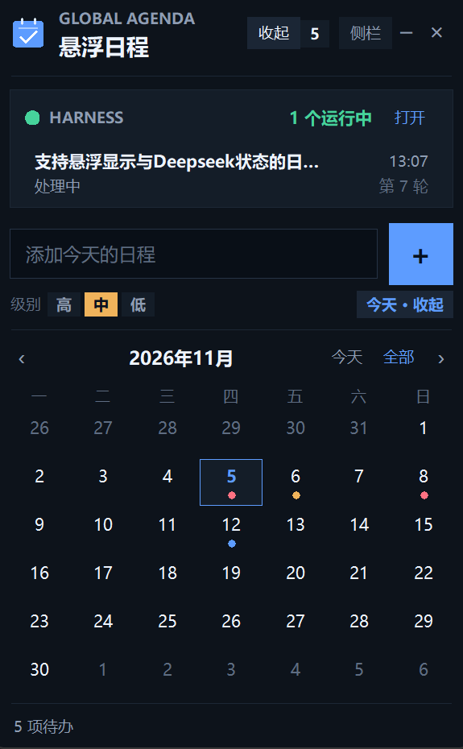

# 悬浮日程

一个独立于 DeepSeek Harness 界面的 Windows 桌面浮窗：始终置顶在所有普通窗口之上，可以记录日程、点击划掉完成项，并同时显示 Harness 中正在运行的会话。它不通过 Harness 的插件系统运行，也不会向 Harness 注册任何 UI。

## 功能

- **全局置顶**：不依赖 Harness 页面，切换到浏览器、编辑器或其他应用时仍然显示。
- **输入日程**：在输入框中输入，按 `Enter` 或点击蓝色 `+` 添加。
- **修改条目**：点条目行尾的“编辑”，文字会载入输入框，可一并修改文字、日期和优先级；按 `Enter` / “保存”提交，按 `Esc` / “取消”放弃，不必删除整条重打。
- **优先级（严重程度）**：高 / 中 / 低三档，用红 / 橙 / 蓝左侧色条和标签标记；新任务可先选优先级。点击任务下方的“高 ▾ / 中 ▾ / 低 ▾”会弹出菜单，可直接把该条目改成任意一档。
- **日历与提前安排**：点顶部“日历”或日期按钮打开月历；有日程的日期下方显示彩色圆点。选中日期后，新输入的任务会直接安排到那一天。
- **日期视图**：选中日期后列表只显示当天日程，视图右侧点“全部”回到所有日程；未设置日期的旧任务只出现在“全部”中。
- **按天计数**：标题旁数字和底部数量只统计当前查看日期的未完成日程（未选日期时就是今天）；折叠胶囊里的数字始终是今天的未完成数量，不再把未来日程算进来。
- **点击完成**：点击日程文字或左侧圆圈，立刻加上删除线；再次点击恢复。
- **删除与清理**：点击行尾 `×` 删除单条；底部“清除已完成”清除当前日期中的已完成项。
- **拖动与折叠**：拖动标题栏移动位置；点 `–` 折叠为小胶囊，胶囊本身也可以按住拖动，单击则展开。
- **Harness 运行状态**：显示正在运行的会话标题、轮次、当前动作和持续时间；点运行中的会话或“打开”可切到 Harness 窗口。运行中的会话显示绿点；如果某个会话在等你批准权限，标题旁、会话行和折叠胶囊的指示灯会变黄，并显示“N 个待授权”。
- **本地持久化**：日程、窗口位置和折叠状态在重启后保留。

## 启动

双击 `启动悬浮日程.vbs` 即可无控制台启动。`悬浮日程.lnk` 是本机快捷方式，不随仓库提供；需要的话可以右键 `启动悬浮日程.vbs` 自行创建快捷方式。

首次启动后窗口默认出现在主屏右上角。

如需查看错误输出，运行 `调试启动.bat`。

### 环境要求

- Windows 10/11
- Python 3.14 或更高版本（使用了标准库 `compression.zstd` 读取 Harness 的压缩会话日志）
- 不需要安装任何第三方 Python 包

### 开机自启（可选）

把 `悬浮日程.lnk` 的快捷方式放入 `shell:startup` 打开的文件夹即可。本程序不会自行修改启动项。

## 操作

| 操作 | 方式 |
|---|---|
| 添加日程 | 输入后按 `Enter` 或点 `+` |
| 修改日程条目 | 点行尾“编辑”，改完按 `Enter` / “保存”；`Esc` / “取消”放弃 |
| 设置新任务优先级 | 输入框下方点“高 / 中 / 低” |
| 修改任务优先级 | 点击任务下方的“高 ▾ / 中 ▾ / 低 ▾”，在菜单中选择 |
| 打开/收起日历 | 顶部“日历”，或输入框下方“日历 · 日期” |
| 提前安排 | 在日历中选择日期，再输入日程 |
| 切换日期 | 再次打开日历选另一天 |
| 查看全部日程 | 日期视图右侧“全部” |
| 查看等待授权 | 指示灯变黄、显示“N 个待授权”；点会话可回到 Harness |
| 查看当天数量 | 标题旁数字、底部数量和胶囊数字只算当天 |
| 完成/取消完成 | 点击日程文字或左侧圆圈 |
| 删除单条 | 点行尾 `×` |
| 清除已完成 | 底部“清除已完成”（仅当前日期） |
| 移动窗口 | 拖动标题栏空白区域 |
| 折叠 | 标题栏右侧 `–`，或按 `Esc` |
| 移动胶囊 | 折叠后按住胶囊拖动 |
| 展开 | 单击小胶囊 |
| 输入框聚焦 | `Ctrl+N` |
| 退出 | 标题栏 `×`、右键菜单“退出”，或 `Ctrl+Q` |
| 打开 Harness | 状态区“打开”或点击运行中的会话 |

## Harness 状态是怎么来的

程序只读 `%USERPROFILE%\.dsh\sessions` 下的会话日志，不读取 Cookie、不调用 Harness 的鉴权 API，也不修改 Harness 的任何状态。

- 每个会话日志中，`turn/start` 后尚未出现 `turn/end`，就视为正在运行。
- 标题来自会话日志里的 `session/title` 事件。
- 当前动作根据最近的事件和尚未返回的工具调用推断，例如“正在执行命令”“读取文件”“等待批准”。
- 收到 `approval/asked` 后、还没看到 `approval/decided` 的会话会标记为“等待批准”，指示灯变黄；批准或拒绝后恢复绿色。
- 每 2 秒刷新一次；DSH 进程不存在时显示“未启动”。

如果 DSH 正在处理一个很长的任务，状态会持续保留；超过 12 小时没有任何事件的悬空 turn 会被忽略。

## 数据位置

- 日程与窗口状态：`%APPDATA%\DshGlobalAgenda\agenda.json`
- 运行日志：`%APPDATA%\DshGlobalAgenda\overlay.log`

日程数据只保存在当前 Windows 用户下，不写入 Harness，也不会上传。每项任务会保存 `severity`（`high` / `medium` / `low`）和 `due`（`YYYY-MM-DD`）；没有日期的任务 `due` 为 `null`。旧数据升级时会自动补为“中”和“未安排”。

## 说明与限制

- “始终置顶”使用 Windows 的 topmost 窗口属性；独占全屏的应用仍可能覆盖它。
- 这是轻量日程，不包含具体时间、重复日程、到期提醒或跨设备同步。
- 日历按周一开头，固定显示 6 周；切换月份不会改变窗口位置。
- 状态读取依赖 Harness 会话日志格式（当前为 v4 JSONL + zstd）。
- 窗口位置按主屏工作区限制；多屏时如需长期放在副屏，需要再调整。
- 关闭程序不会丢失数据；删除数据目录即可清空。

## 卸载

1. 从右键菜单退出程序。
2. 删除本目录。
3. 如需清除数据，再删除 `%APPDATA%\DshGlobalAgenda`。
